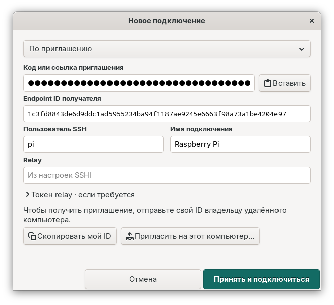
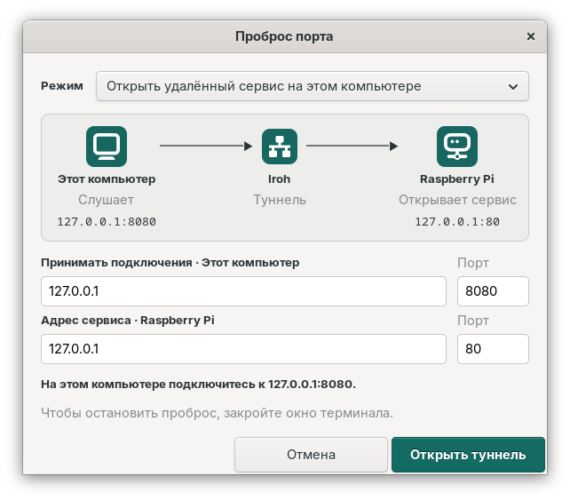

<p align="center"></p>

# SSHI

SSH по публичному Iroh Endpoint ID. На Raspberry Pi, сервере или ноутбуке получателя работает обычный OpenSSH. Обе стороны устанавливают исходящее соединение с relay. Для доступа из интернета достаточно работающего relay и локального `sshd` на получателе.

SSHI сохраняет именованные подключения, открывает несколько терминалов через один туннель и позволяет пригласить новый компьютер через Iroh. На Linux и macOS графический клиент и CLI используют одни настройки и профили.

**[Скачать SSHI 0.4.1](https://github.com/gadmin2151/sshi/releases/tag/v0.4.1)** · [Первый вход](#первый-вход) · [Docker Compose](docs/docker.md) · [Сборка из исходников](docs/build.md)


## Установка

| Система | Пакет | Запуск |
| --- | --- | --- |
| Debian / Ubuntu, Intel и AMD x64 | `sshi_0.4.1_amd64.deb` | SSHI в меню приложений или `sshi-desktop` |
| Raspberry Pi / Debian ARM | `sshi_0.4.1_arm64.deb` или `sshi_0.4.1_armhf.deb` | Та же программа или CLI на сервере |
| Arch Linux / CachyOS x64 | `sshi-0.4.1-1-x86_64.pkg.tar.zst` | `sudo pacman -U ./sshi-0.4.1-1-x86_64.pkg.tar.zst` |
| Linux с RPM | `sshi-0.4.1-1.x86_64.rpm` или `sshi-0.4.1-1.aarch64.rpm` | `sudo dnf install ./sshi-0.4.1-1.*.rpm` в каталоге с одним пакетом |
| Windows x64 | `sshi-0.4.1-windows-x64.exe` | Запустите портативный EXE |
| macOS 12+ на Apple Silicon | `sshi-0.4.1-macos-arm64.pkg` | Откройте установщик, затем SSHI в «Программах» |

На Debian выполните в каталоге загрузки:

```sh
sudo apt install "./sshi_0.4.1_$(dpkg --print-architecture).deb"
sshi --version
man sshi
```

На сервере без рабочего стола добавьте к `apt install` параметр `--no-install-recommends`. Пакет для macOS устанавливает также `sshi`, `sshi-copy-id`, `sshi-copy-iid` в `/usr/local/bin`. Пакеты macOS и Windows распространяются без сертификата издателя. Для проверки загрузки сверьте SHA-256 с файлом `SHA256SUMS` этого выпуска. Если macOS запросит подтверждение издателя, следуйте [инструкции Apple по открытию загруженных приложений](https://support.apple.com/en-us/102445).

## Первый вход

**1. Настройте relay на обоих компьютерах.** Возьмите URL и, если нужен, токен у администратора relay. В графическом клиенте откройте настройки relay или профиль Windows. На Linux и macOS доступны команды:

```sh
sshi config set-relay https://relay.example.org/
sshi config set-token
sshi config show
```

Замените адрес на действующий. Вторая команда запрашивает токен скрыто и нужна только для relay с авторизацией. Пакет использует системный URL из `/etc/sshi/config.toml`, пока пользователь не выберет свой.

**2. Запустите получателя.** На Debian установите `openssh-server` и запустите следующие команды под пользователем, который будет обслуживать Iroh-подключения:

```sh
sshi id
systemctl --user enable --now sshi
```

На macOS для принимающей стороны включите «Удалённый вход» в настройках общего доступа и запустите `sshi serve` в терминале. Сохраните выведенный Endpoint ID получателя. Для проверки службы Linux используйте `journalctl --user -u sshi -f`.

**3. Откройте «Новое подключение → По приглашению» на Mac, Windows или Linux.** Если владелец сервера уже прислал два значения, вставьте **его Endpoint ID** в поле получателя и **выданный вам код** в поле приглашения. Введите имя реальной учётной записи SSH на сервере (например, `pi`). Можно выбрать удобное имя подключения. Подтвердите приглашение и откройте SSH.



Если кода ещё нет, нажмите **«Скопировать мой ID»** и отправьте этот публичный ID владельцу получателя. Он должен выпустить приглашение именно для этого компьютера. Mac и Windows на разных устройствах имеют отдельные ID.

**Владельцу получателя.** На Linux или Mac с SSHI 0.2.2 или новее выполните команду под пользователем, который запустил `sshi serve`. Подставьте ID гостя и имя SSH-пользователя для входа.

```sh
sshi invite "$CLIENT_ID" --share --user pi
```

Отправьте гостю полученную строку `sshi://invite/…`. Её вставляют целиком в то же поле приглашения. Перед подтверждением клиент показывает Endpoint ID получателя, SSH-пользователя и relay. Если на получателе более ранняя версия, выполните `sshi invite "$CLIENT_ID"` и передайте гостю код вместе с результатом `sshi id` на получателе. Срок действия нового кода — десять минут. Приглашение предоставляет доступ через Iroh. Для SSH нужен разрешённый на сервере пароль или ключ. Для частного relay может также понадобиться его токен, который администратор передаёт отдельно.

На Mac и Linux можно выдать приглашение на свой компьютер из графического интерфейса. Для Windows как клиента приглашение на удалённый сервер можно выпустить через уже разрешённое подключение к этому серверу.

**Вход из CLI.** Для обычного входа достаточно одной команды. Если получатель ещё не разрешил ID вашего компьютера, SSHI покажет этот ID и прямо в терминале предложит вставить код или ссылку. Ввод скрыт. После принятия приглашения откроется обычный SSH-вход. Пустой Enter отменяет попытку.

```sh
sshi "user@$RECEIVER_ID"
```

Чтобы принять приглашение отдельно, выполните `sshi invitation redeem` для ссылки или `sshi invitation redeem --endpoint "$RECEIVER_ID"` для кода. Вставьте приглашение в скрытый запрос. В скрипте передайте его в стандартный ввод команды `invitation redeem` до запуска SSH.

Если в вашем OpenSSH задан короткий `ConnectTimeout`, получите код перед входом или примите его отдельной командой. На Windows тот же интерактивный вход доступен через `.\sshi-0.4.1-windows-x64.exe user@ID`.

При первом входе сверьте отпечаток SSH-сервера. Для входа по ключу выполните `sshi-copy-id "user@$RECEIVER_ID"` при наличии локального публичного SSH-ключа или используйте действие установки ключа в интерфейсе. Создать следующее приглашение можно с уже доверенного компьютера через сохранённое подключение. Если учётная запись SSH отличается от владельца службы, укажите владельца службы при выдаче приглашения.

## Подключения, терминалы и резервные копии

Создайте профиль в окне SSHI или сохраните его из CLI. Пустое поле relay использует настроенный адрес этого компьютера.

```sh
sshi profile save --name "Мастерская" --user user --endpoint "$RECEIVER_ID"
sshi connect "Мастерская"
sshi profile list
sshi list
```

В списке один щелчок выделяет подключение, двойной открывает терминал. Чтобы переименовать профиль, выделите его, подождите дольше системного интервала двойного щелчка и щёлкните по имени ещё раз. В CLI та же операция доступна через `sshi profile rename --name "Мастерская" --to "Сервер мастерской"`.

Каждое открытие профиля запускает отдельный SSH-терминал. Терминалы к одному получателю используют общий Iroh-туннель до закрытия последнего окна. SSH-аутентификация выполняется отдельно для каждого входа.

### Заметки и резервные копии

Выберите сохранённое подключение и откройте **«Заметки»**. На Linux и macOS в карточке видно начало записи. На Windows запись открывается кнопкой **«Заметки…»**. Введите текст и нажмите **«Сохранить»**. При переименовании профиля запись остаётся с ним. На Linux и macOS заметки можно читать и записывать из терминала.

```sh
sshi profile notes --name "Мастерская"
sshi profile notes --name "Мастерская" --set < ./notes.txt
```

```sh
sshi backup ./workshop.sshi-backup.json
sshi restore ./workshop.sshi-backup.json
```

Команды экспорта и импорта есть в меню всех трёх клиентов. JSON переносит имена профилей, пользователей, публичные Endpoint ID, адреса relay, заметки и историю. При восстановлении совпадающего профиля из копии заполняются пустые заметки. Если у профилей с одним именем разные настройки или разные заполненные заметки, импорт сообщает о конфликте. На другом компьютере отдельно введите токен, разрешите его собственный Endpoint ID, выберите SSH-ключ и сверьте отпечаток сервера.

## Проброс портов

Выделите профиль и откройте проброс портов. Выберите, с какого компьютера нужен доступ к сервису. Схема показывает, где откроется порт и с какой стороны SSH подключится к сервису. Адрес и порт вводятся в отдельные поля.



| Задача | Пример | Куда подключиться |
| --- | --- | --- |
| Открыть сайт Raspberry Pi на ноутбуке | Порт ноутбука `8080` → SSH → `127.0.0.1:80` со стороны Pi | В браузере ноутбука откройте `http://127.0.0.1:8080` |
| Открыть приложение ноутбука с Raspberry Pi | Порт Pi `9000` → SSH → `127.0.0.1:3000` со стороны ноутбука | На Pi откройте `http://127.0.0.1:9000` |
| Использовать SOCKS через Pi | Приложение на ноутбуке → SOCKS на `127.0.0.1:1080` → SSH → адрес, выбранный приложением | Укажите в приложении SOCKS5 и `127.0.0.1:1080` |

По умолчанию порт слушает на `127.0.0.1` выбранного компьютера. Окно терминала обслуживает проброс. Чтобы остановить его, нажмите в этом окне Ctrl+C. На Linux и macOS проброс можно запустить по имени профиля.

```sh
sshi forward --profile "Мастерская" --kind local --bind-port 8080 --target-host 127.0.0.1 --target-port 80
```

В CLI также доступен обычный синтаксис OpenSSH.

```sh
sshi -N -L 127.0.0.1:8080:127.0.0.1:80 "user@$RECEIVER_ID"
sshi -N -R 127.0.0.1:9000:127.0.0.1:3000 "user@$RECEIVER_ID"
sshi -N -D 127.0.0.1:1080 "user@$RECEIVER_ID"
```

На Windows встроенный терминал открывается кнопкой подключения. Кнопка «Проброс портов…» запускает системный OpenSSH для Windows и использует тот же Iroh-туннель. OpenSSH использует свой список проверенных SSH-серверов и свой агент или выбранный файл ключа. Из командной строки доступна команда `proxy` портативного клиента. Пример для PowerShell рассчитан на запуск в каталоге с EXE и профиль с именем `Workshop`:

```powershell
ssh -N -L 127.0.0.1:8080:127.0.0.1:80 -o 'ProxyCommand=./sshi-0.4.1-windows-x64.exe proxy Workshop' "user@$ReceiverId"
```

## Передача файлов

В SSHI выберите подключение и нажмите **«Файлы»**. Слева папки этого компьютера, справа папки получателя. Двойной щелчок по папке открывает её, а по текстовому файлу открывает встроенный редактор. Можно изменить файл и сохранить его в той же папке. Редактор открывает файлы UTF-8 до 2 МиБ и сообщает, если содержимое изменилось после открытия.

В каждой панели есть меню **«Действия»**, которое также открывается правым щелчком. Выберите **«Копировать»** или **«Вырезать»**, перейдите в нужную папку на любой стороне и нажмите **«Вставить»**. В этом же меню доступны переименование, создание папки и удаление с подтверждением. Перетаскивание между панелями, **«Загрузить»** и **«Скачать»** копируют файлы и папки. Внизу отображается ход передачи.
На Linux и macOS файловое окно использует ключи OpenSSH и может подключиться через активный SSH-сокет. При первом подключении или входе по паролю выберите **«Войти в терминале»** и дождитесь готовности сокета. На Windows пароль и подтверждение отпечатка SSH-сервера запрашиваются в файловом окне.

Из CLI передайте один локальный и один удалённый путь. Для удалённого пути используйте имя сохранённого подключения или `user@EndpointID`. `cp` и `--cp` равнозначны.

```sh
sshi --cp ./archive.tar.gz 'Мастерская:/home/user/Загрузки/'
sshi --cp 'Мастерская:/home/user/отчёт.pdf' ./
sshi --cp -r ./photos 'Мастерская:/home/user/backup/'
```

При необходимости укажите приватный ключ параметром `-i`. Файлы передаются по SFTP через тот же relay Iroh. На получателе должна быть включена подсистема SFTP в OpenSSH. Если файл назначения уже существует, SSHI сохранит его и покажет ошибку. Для копирования выберите другое имя или папку.

## SSH-сокет для терминала или Codex

На Linux и macOS выберите сохранённый профиль и нажмите **«Включить»** в его карточке **«SSH-сокет»**. При входе по ключу статус прямо в карточке изменится на **«Включён»**. Если SSH потребуется подтверждение или пароль, нажмите **«Войти в терминале»**. После входа в карточке появится кнопка **«Скопировать команду»** для Codex. Добавьте к ней `hostname`, чтобы вывести имя удалённого компьютера, или запустите её без аргументов для интерактивного терминала.

Если подключиться не удалось, подробности появятся в разделе **«Ошибка сокета»** в этой же карточке.

Те же действия доступны через CLI. Вместо «Мастерская» укажите имя из `sshi profile list`.

```sh
sshi socket start "Мастерская"
sshi socket command "Мастерская"
sshi socket check "Мастерская"
sshi socket close "Мастерская"
```

Параметр `start --batch` запускает OpenSSH с ключом и настройками текущего пользователя в режиме без запросов. Команда `start` создаёт сокет на этом компьютере, в личном каталоге `/tmp/sshi-UID/`. Только пользователь, запустивший его, может повторно использовать аутентифицированный сеанс. `command` печатает готовую команду OpenSSH, а `path` выводит только путь. Если сокет закрыт, скопированная команда завершится ошибкой. Повторный `start` возвращает уже работающий сокет. После завершения последней команды мастер по умолчанию ждёт 700 минут. Укажите, например, `sshi socket start --persist 30m "Мастерская"` при запуске нового мастера. При `close` завершаются также сеансы, использующие этот сокет.

## Настройки и обновление

В настройках приложения выберите «Русский» или «English». Пункт «Что нового» открывает описание установленной версии на GitHub. [Изменения в 0.4.1](https://github.com/gadmin2151/sshi/releases/tag/v0.4.1)

При открытии графический клиент проверяет последний стабильный выпуск на GitHub и повторяет проверку каждые шесть часов, пока приложение открыто. Если вышла новая версия, появится кнопка с её номером. Нажмите её, скачайте предложенный пакет и установите его. В Windows закройте старую копию SSHI и запустите новый портативный EXE. Для ручной проверки откройте **Настройки → Проверить обновления** или выполните `sshi update`. Ключ `--json` выводит результат для скриптов.

| Что хранится | Где искать |
| --- | --- |
| Системный relay, локальный адрес `sshd`, вручную разрешённые ID | `/etc/sshi/config.toml` на получателе |
| Настройки и токены текущего пользователя | `~/.config/sshi/` на Linux и macOS |
| Iroh-идентичность, история, профили и приглашения | `~/.local/state/sshi/` пользователя, запустившего SSHI |
| Профили, закреплённые SSH-ключи серверов и защищённые DPAPI данные на Windows | Скрытая папка `.sshi` в «Документах» текущего пользователя |

`sshi config show` выводит выбранный relay, путь конфигурации и адрес `sshd`. Команда `sshi config reset-relay` возвращает системный адрес для текущего пользователя. Для отдельного профиля используйте `sshi profile run --name "Мастерская" -- config show`. Для ручного доступа добавьте публичные ID клиентов в TOML-массив `allow_clients`. Служба перечитывает список при новом подключении. Новые настройки relay и адреса `sshd` вступают в силу при следующем запуске службы. На Linux выполните `systemctl --user restart sshi` от её владельца, когда можно закрыть текущие сеансы.

При обновлении с 0.1.4 сохраните прежний каталог данных и владельца службы. Это сохраняет Endpoint ID, доверие и историю. После обновления перезапустите получатель.

## Разработка

Описание сборки и проверок приведено в [руководстве разработчика](docs/build.md). Условия распространения указаны в [лицензии MIT](LICENSE).
